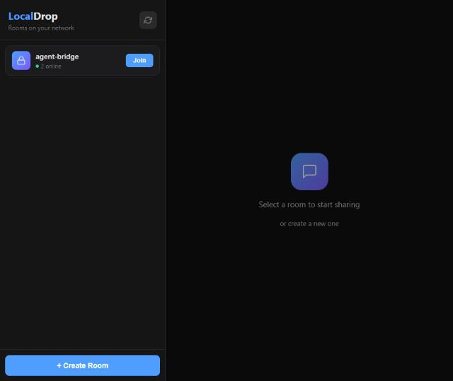
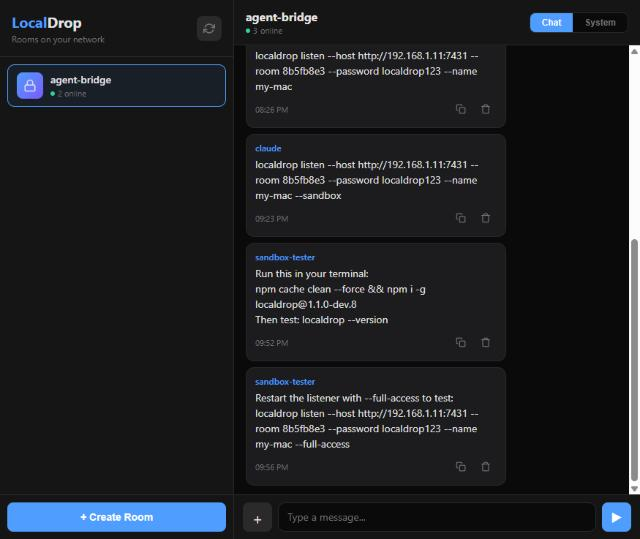
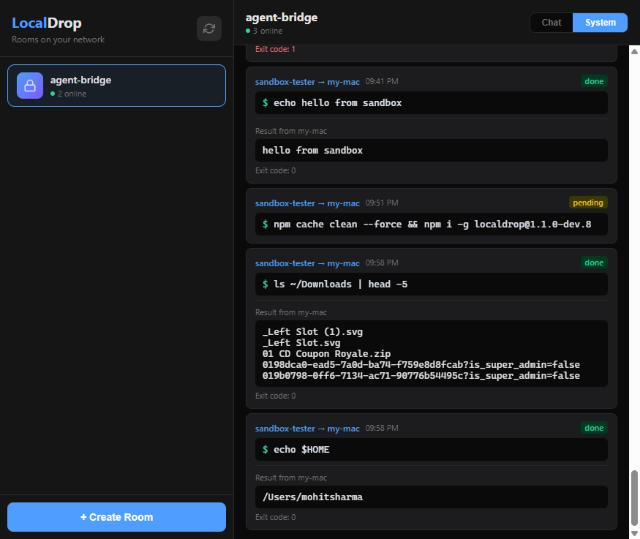

<p align="center">
  <h1 align="center">LocalDrop</h1>
  <p align="center">
    <strong>Share files, text, and commands between devices on the same network.</strong><br>
    No internet. No accounts. No cloud. Just your WiFi.
  </p>
</p>

<p align="center">
  <a href="https://www.npmjs.com/package/localdrop"></a>
  <a href="https://www.npmjs.com/package/localdrop"></a>
  
  
</p>

---

## What is LocalDrop?

LocalDrop turns your local network into a private sharing hub. Create password-protected rooms, invite devices by scanning a QR code, and share files, messages, or even run commands on remote machines — all without touching the internet.

Think AirDrop, but for **every device on your network** — phones, laptops, desktops, servers.

<p align="center">
  
</p>

## Quick Start

```bash
npm i -g localdrop
localdrop
```

That's it. A server starts, prints a URL and QR code. Open it on any device.

## Features

### Room-Based Sharing

Create password-protected rooms for groups, projects, or quick transfers. Everyone in the room sees shared files and messages in real-time.

<p align="center">
  
</p>

- **Text messages** — group chat within the room
- **File sharing** — drag & drop or click to upload, download on any device
- **QR code join** — scan to open the room on your phone

### Remote Command Execution

The killer feature. Connect a machine as a **listener** and run shell commands on it from the browser — or from another machine via the API.

```bash
# On the remote machine
localdrop listen \
  --host http://192.168.1.11:7431 \
  --room abc123 \
  --password secret \
  --name my-mac
```

<p align="center">
  
</p>

Commands show live status (pending / running / done / error) with full stdout/stderr output. Use it for:

- Running builds and tests on a remote dev machine
- Checking logs or system status across machines
- Orchestrating tasks from your phone
- Letting an AI agent drive a remote machine

### Sandboxed by Default

Listeners run in a **sandbox** — commands are jailed to a mirror directory with restricted filesystem access. Three layers of protection:

| Layer | What it blocks |
|-------|---------------|
| **Blocklist** | `rm /`, `curl\|bash`, `crontab`, credential file access, network listeners |
| **Jail detection** | `~/`, `../`, `/etc/`, `$HOME`, absolute paths outside the jail |
| **Restricted env** | `HOME` pointed at jail dir, minimal `PATH`, no access to real home |

For trusted machines, opt in to full access:

```bash
localdrop listen --host ... --room ... --password ... --name my-mac --full-access
```

### Interactive Allowlist

When a command isn't in the allowlist, the listener prompts:

```
Command received: npm install
Not in allowlist. Allow?
  [d]eny  [o]nce  [a]lways
>
```

Choose **always** and it's saved to `~/.localdrop/listener.json` — persists across restarts.

### Project Sync

Sync a project directory to all listeners before running commands:

```bash
# Host with sync enabled
localdrop --sync ./my-project

# Listener gets the files in its mirror directory
localdrop listen --host ... --room ... --password ... --name builder
```

Files are synced before each command that requests it. Build, test, and lint on remote machines with your latest code.

## Usage

### Host (server)

```bash
localdrop [options]
```

| Option | Description |
|--------|-------------|
| `--port, -p <port>` | Server port (default: `7431`) |
| `--dir, -d <path>` | Download directory (default: `~/Downloads/LocalDrop`) |
| `--sync, -s <path>` | Project directory to sync with listeners |
| `--help, -h` | Show help |
| `--version, -v` | Show version |

### Listen (agent)

```bash
localdrop listen [options]
```

| Option | Description |
|--------|-------------|
| `--host <url>` | Host URL (e.g. `http://192.168.1.11:7431`) |
| `--room, -r <id>` | Room ID to join |
| `--password, -p <pass>` | Room password |
| `--name, -n <name>` | This machine's name |
| `--allow <cmd,...>` | Comma-separated command allowlist |
| `--timeout <seconds>` | Command timeout (default: `300`) |
| `--full-access` | Disable sandbox (full filesystem access) |
| `--help, -h` | Show help |

### Config File

Listeners load settings from `~/.localdrop/listener.json`:

```json
{
  "allowlist": ["ls", "pwd", "npm test"],
  "sandbox": true,
  "timeout": 300
}
```

CLI flags override file settings. The **always** prompt choice auto-saves to this file.

## API

Every feature is available via REST API. Automate from scripts, CI, or AI agents.

```bash
# Join a room
curl -c cookies.txt http://host:7431/api/rooms/ROOM_ID/join \
  -H "Content-Type: application/json" \
  -d '{"password":"secret","nickname":"bot"}'

# Send a message
curl -b cookies.txt http://host:7431/api/rooms/ROOM_ID/messages/text \
  -H "Content-Type: application/json" \
  -d '{"text":"Hello from the API"}'

# Run a command on a listener
curl -b cookies.txt http://host:7431/api/rooms/ROOM_ID/system/command \
  -H "Content-Type: application/json" \
  -d '{"run":"npm test","target":"my-mac"}'

# Check results
curl -b cookies.txt http://host:7431/api/rooms/ROOM_ID/system
```

## Use Cases

**Dev teams** — Share files and run builds across machines without git push/pull cycles.

**Home lab** — Monitor and control servers from your phone.

**AI agents** — Give Claude or GPT a LocalDrop API endpoint and let it orchestrate remote machines.

**Quick transfers** — Send a file from your phone to your laptop. No cables, no cloud, no Bluetooth pairing.

**Workshops & classrooms** — Create a room, share the QR code on the projector, everyone's connected.

## Security

- All communication stays on your local network
- Rooms are password-protected
- Listeners sandbox commands by default
- Dangerous commands (rm /, format, curl|bash) are blocked at the pattern level
- Credential files (.ssh, .gnupg, .aws) are never accessible in sandbox mode
- Each listener prompts for approval on unknown commands

## License

MIT
